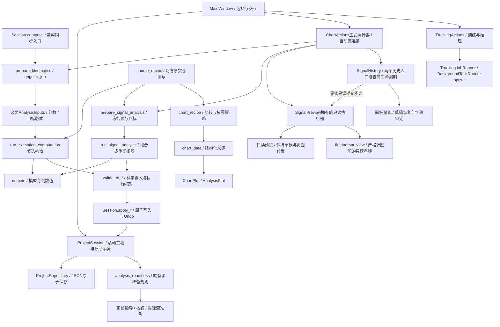
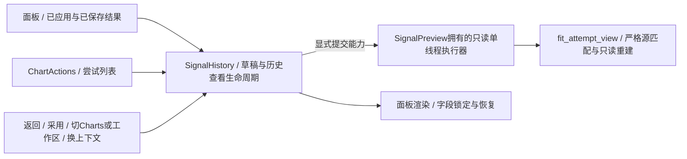

# Architecture — AI Physics Tracker

本文档顶部记录**当前已落地架构**，后文保留高层设计 / 演进依据。实施状态见[重构进度](status/architecture-progress.md)，本轮工作见[current.md](status/current.md)；旧扫描不作为当前实现。R01–R04 / R08均已完成 / 已合并，[R07工程变更与界面更新方案](status/change-notification-proposal.md)已由用户搁置、未实施；2026-10-20用户确认[R08](status/signal-history-plan.md)本轮HR“通过”，f34d3b8已集成main；下图及历史查看细图均为当前已落地关系。

## 当前架构总览（接手先读）

2026-10-20用户确认R08真人验收“通过”，f34d3b8以--no-ff集成main。合并树与8dacc45一致，源码 / 测试与最终验收703ac81一致；本机1329 / 独立R2 Approve / 双平台 / 本轮HR通过，F1 Closed。此前6.1 / 6.2 / 6.3 / 6.3.1、自动Near-CFR及R01–R04均已集成；R04原基线085219e / bd848f1的完成证据保留在对应计划 / Review。



| 规则 / 工作 | 唯一owner或既有调用关系 |
| --- | --- |
| 领域 / 数值 | domain模型、kinematics / angular / expression / function_fit / recurrence；不依赖Qt / application |
| 必要输入 / 运动学候选构造 | motion_computation拥有AnalysisInputs和线性 / 角运动记录构造；不依赖Session / Qt / 文件；旧kinematics_job导入路径再导出同一类型 |
| 准备 / 运行 / 科学核对 | kinematics_job / angular_job / signal_analysis_job；任务值不携带Session，采集时复制必要嵌套值；同步 / 后台共用路径，保留各类专属核对 |
| 活动工程 / 原子写入 / Undo | ProjectSession / TrackStore；apply_*和_commit_store保留事务所有权；compute_*仅协调prepare/run/apply；未知扩展在受控发布时合并 |
| 配方事实 / 读写 | source_recipe；chart_recipe仅保留图表比较 / 披露 / 行读取策略及兼容再导出 |
| 源可操作事实 | analysis_readiness.assess_signal_source复用prepare_signal_source；SignalSourceState分别保留基础问题 / 源问题 / 可准备任务，供顶部指导、按钮及实际准备共用；不替代正式发布核对 |
| 正式分析 | ChartActions单executor→既有job→GUI主线程apply；自动补源也使用此链路，Fit / Measure仍显式 |
| 草稿预览 / 交互 | SignalPreview独立executor（ADR-0023）；只读输入，旧值核对后显示，不发布结果 / 日志 / Undo；页面位置、缩放、焦点、草稿归GUI |
| 历史与日志 | SignalHistory拥有保存结果 / 拟合尝试的进入、返回、采用及Future / QTimer / 迟到核对；经显式提交能力共用SignalPreview拥有的只读池，关闭先历史后资源；fit_attempt_view按严格源身份重建；ChartActions / FitAttempts / FitAttemptJournal协调独立日志 |
| 草稿上下文 | analysis_draft_context（Qt-free）拥有工具页导航事实（DraftContextFacts / NavigationFacts）与源准备迟到判定（SourceDeliveryStamp / source_delivery_stale，求值位次与旧手写链一致）；MainWindow采集、导航键 / 预览键共享成员 / _poll迟到核对集中消费；分析簇枚举的跨模块私有访问经公开入口（panel视图状态方法、closed / signalJobActive / prepareSignal / currentWorkflowState / applyAnalysisMethod） |
| 工作流与AI | TrackingActions同轮复用ExecutionInput，真实review状态改变后重采集；现有spawn / 取消 / terminate / kill / reap保持，候选显式激活后才改观测 |
| 解码交付 | MainWindow的SimpleQueue + 无参Qt signal→GUI drain→generation / request_id核对；禁止worker直接发携带Python对象的信号 |
| 保存与时序 | ProjectActions独立保存，文件写入阶段不可取消；显式Save与autosave的历史语义保持；TimingActions按ADR-0024自动采用合格Near-CFR |

**R04已退出的旧路径**：Session内运动学计算 / 候选装配、job.snapshot.compute_*、MainWindow只按源是否存在推断可用、同轮重复采集执行事实。自动源任务的启动 / 取消 / 失败只更新jobLabel，显式Preview自己发定位信号；F1与R03橙线更新共同保持页面位置。频繁比较事实的analysis_inputs不深拷贝整个Project；detached()继续服务保存等既有用途。

当前GUI仍通过analysisChanged等通知协调多个页面，保存 / 导航也会触发此通知，消费方自行核对是否需要更新；[R07方案](status/change-notification-proposal.md)曾拟梳理这条链路，用户现已搁置，未实施。已有失效传播与迟到拒绝保护有效，不能以方案中的目标替换当前事实。

不存在全局JobSupervisor、WorldSnapshot、通用计算框架或统一图表widget；R05 / R06继续后置。历史设计若与顶部 / ADR / 代码冲突，应修正文档，不恢复旧实现。当前设计依据为[ADR-0027](decisions/0027-analysis-computation-and-publication.md)。


## R08 历史查看关系（已完成 / 已合并main）

f34d3b8已集成验收产品703ac81；[计划](status/signal-history-plan.md) / [Review](reviews/signal-history-review.md)。本机1329 / 独立R2 Approve / 双平台及本轮HR全部通过，F1 Closed。



SignalHistory拥有历史请求Future / QTimer、记录身份和工程 / 代际 / 视频 / 时序核对；`changing`只协调旧预览 / 自动源失效，`historyChanged`只更新上下文显示，避免新请求被回调误取消。退出先拒收旧请求再恢复草稿；关闭先历史shutdown再预览资源shutdown。执行器仍为正式与只读各一个；ChartActions保留正式计算和FitAttempts日志协调，面板保留记录渲染，application重建及Session发布不改。

R08已退出的旧路径：`ChartActions._viewAttempt` / `_pollHistory` / `_cancelHistory`及`_history*`状态，历史代码直接读`preview._executor`，主窗口退出历史后重复失效预览。已有`displaySaved` / `restoreSaved`面板入口为兼容委托，不是第二份查看流程。

## R09 草稿上下文集中（2026-10-24已集成main）

c14c78a集成已验证产品ad00f9c（首版f769215）；[计划](status/draft-context-plan.md) / [Review](reviews/draft-context-review.md) / [PR #41](https://github.com/KYLeonis/ai-physics-tracker/pull/41)。本机1337 / 两独立Agent Approve（2项Minor已闭环）/ 双平台通过；无用户可感知变化，不设HR。

`application/analysis_draft_context.py`是GLOSSARY「草稿上下文（Draft Context）」的实现载体：`MainWindow.draftContextFacts()`采集8项廉价导航事实，`analysisNavigationKey`附上按需的源准备原因；`SignalPreview.syncContext`键的共享成员与`ChartActions._poll`的源准备迟到核对集中到`source_delivery_stale`（selection延迟求值、保持在workspace判定之前，异常传播路径与旧or链一致）。`_source_selection` / `_source_method`合并为提交时冻结的`_source_stamp`。

R09已退出的旧路径：三处手写键 / 核对清单、`_source_selection` / `_source_method`散字段，及分析簇枚举的跨模块私有读写（SignalPreview / SignalHistory直接触碰panel视图状态私有字段、读`actions._closed` / `_signal_job` / `_prepareSignal`、MainWindow读`trackingActions._current_workflow_state`与`window._analysisMethodChanged`调用）。signal_history对panel的六个遗留私有访问（`_loading`等）不在本轮清单，待后续清理；源扫描回归守卫枚举集。

---

## 1. 系统总览

AI Physics Tracker 是一个单机桌面应用，内部由四层组成：

```text
┌─────────────────────────────────────────────────────────┐
│                     GUI 层（PySide6）                     │
│  主窗口 · 视频视图 · 时间轴 · 标定工具 · 标注工具 ·        │
│  图表面板 · 训练/推理任务面板 · 模型库管理                  │
├─────────────────────────────────────────────────────────┤
│                     应用服务层                            │
│  项目生命周期 · 视频播放控制 · 标定/坐标系服务 ·            │
│  标注服务 · AI 训练/推理任务编排 · 模型库服务 · 导出服务    │
├─────────────────────────────────────────────────────────┤
│                     领域/核心层                           │
│  数据模型（Project/Video/Track/Annotation/Calibration）·  │
│  运动学计算引擎 · 数据处理（平滑/插值/异常值）·            │
│  困难帧检测 · 物理量派生                                  │
├─────────────────────────────────────────────────────────┤
│                     基础设施层                            │
│  持久化 · DeepLabCut/PyTorch 适配器 · 视频解码（OpenCV/    │
│  FFmpeg）· 后台任务执行器 · 日志 · 配置                    │
└─────────────────────────────────────────────────────────┘
```

设计原则：

- **GUI 与核心分离**：领域/核心层不依赖 Qt，可独立测试；GUI 只做展示与交互。
- **数据先行**：手工跟踪与 AI 跟踪使用统一数据体系（Phase 1 的核心目标），AI 只是轨迹数据的另一种来源。
- **适配器隔离**：DeepLabCut/PyTorch 通过适配层接入，未来可替换为其他视觉模型（ONNX/OpenVINO 等）而不影响上层。
- **分层务实边界**：domain 保持零框架依赖；GUI 不 import infrastructure；application 与 infrastructure 之间允许**公共符号**的相互 import（引擎适配器构造、跨进程值对象），但跨包下划线私有符号、相对导入与各层禁用的第三方包（Qt/OpenCV/DLC）由 `tests/test_layer_boundaries.py` 的 AST 规则强制禁止（Subphase 4.5 R2 review 固化）。
- **长任务后台化**：训练、推理、视频导出全部为可取消的后台任务，GUI 保持响应。

Phase 2.4 项目候选提交见 [ADR-0006](decisions/0006-project-workflow-and-timing-gate.md)；
首帧预览/后台时序验证与显式近似测量见
[ADR-0007](decisions/0007-responsive-preview-and-explicit-timing-approximation.md)。

2026-10-17起合格Near-CFR由TimingActions在主线程自动调用既有应用层接受守卫；同一入口覆盖同步接管和后台交付，重开重新检测，不再弹出Yes。新来源区分auto与旧user accepted；原误差预算、未知 / VFR / 身份与迟到守卫不变。见[ADR-0024](decisions/0024-automatic-near-cfr-acceptance.md)。
`ProjectMediaService` 产生只读验证请求/结果，`TimingActions` 按固定加载代际在 GUI
线程合并验证状态，不让后台任务替换用户正在编辑的 Project 快照。

## 2. 核心数据体系（Phase 1 起细化）

统一数据模型将围绕以下概念组织（示意，非最终接口）：

| 概念 | 说明 |
| --- | --- |
| Project | 一次实验分析会话：引用视频、标定、轨迹集合、模型引用 |
| Video | 文件路径、帧率、总帧数、分辨率等元数据；不包含帧像素 |
| Timeline | 帧号 ↔ 时间的映射、0-based 帧约定与 working zone |
| Track | 一个跟踪目标在全部帧上的轨迹数据序列 |
| TrackPoint | 单帧单目标观测：像素坐标 + confidence + 来源（manual/ai） |
| Annotation | 用户手工标注（是 TrackPoint 的一种来源，同时是 AI 训练数据） |
| Calibration | 比例尺（像素↔物理长度）、坐标原点、轴方向/旋转 |
| DerivedData | 由原始 Track 经标定/平滑/微分等得到的派生数据，原始数据永不覆盖 |

关键约定：**原始跟踪数据只增不改**；所有处理（平滑、微分、拟合）产生的派生数据分层存放，保证可回溯、可重新处理（对应导出需求中的"保留原始跟踪数据"）。

## 3. AI 跟踪子系统（Phase 4 起细化）

```text
手工标注（Annotation）
      ↓  转换器
DeepLabCut 项目（labeled-data / training-datasets）
      ↓  训练任务（后台）
DLC 模型（dlc-models, PyTorch engine）
      ↓  推理任务（后台, 含 confidence）
推理结果 → 转换回统一 TrackPoint（含 confidence, source=ai）
      ↓
困难帧检测（低置信度 / 轨迹异常）→ 引导用户修正 → 回到训练（主动学习闭环）
```

- 标注数据双向转换：内部模型 ↔ DLC CollectedData 格式。
- 模型库（Phase 7）记录模型元数据与来源实验，支持在新视频上复用并补充标注微调。
- 推理输出必须携带 per-point confidence，供困难帧检测与图表着色使用。

Phase 4.3/4.4 实现遵循 [ADR-0011](decisions/0011-deeplabcut-integration-architecture.md) 与
[ADR-0012](decisions/0012-gui-tracking-task-boundaries.md)：`prepare_tracking_request` 捕获不可变项目、
媒体与参数快照 → `TrackingJobRunner` 启动唯一 spawn worker → `prepare_training` 或
`prepare_inference` 建立 DLC 输入 → `DLCAdapter` 执行 → 适配层 `dlc_predictions` 严格解析
→ 原始文件与校验后的观测交换文件存入本次 run 目录。
队列仅传进度、日志和结果摘要；主进程确认上下文、实际引用与轻量文件状态未变后，通过
`ProjectSession.import_engine_points` 一次提交观测、run 完成状态和派生失效。
取消/错误不提交半批结果。`effective_points` 是运动学与后台输入校验共同的数据入口，
`manual_points` 仍仅供人工标注和训练使用。GUI 视觉/按钮接线留到 4.4。

TaskPanel/TrackingActions 仅捕获请求和提交候选；spawn worker 独占 DLC、reader、训练/评价/
推理与日志，结果解析/重合并在后台线程。主线程用会话/媒体代际和 Project 快照身份提交，
保存保持活动 session 身份。AI 链路采用轻量文件状态，不反复哈希；数据结构、时序、
snapshot、first-wins 和原子提交校验保留。Manual 圆形、AI 空心菱形，帧高亮索引更新。
Phase 5.0 已移除旧 Training/Inference coordinator 的 start/poll/cancel 状态机；prepare/read
保留为无生命周期状态的模块边界。`TrackingJobRunner` 统一启动，`BackgroundTaskRunner` 管理
进程/句柄，`TrackingActions` 负责轮询、取消触发与活动 session 提交；三者组成唯一生命周期路径。

Phase 5 的 Accepted 目标边界见 [phase5-requirements.md](spec/phase5-requirements.md)：初始取帧复用
DLC uniform/K-means；困难帧使用原始预测的多信号候选与本项目 ranking/de-dup/diversity 策略；
Accept 不产生 ground truth，Correct 才写 manual；completed infer result 与 active result 分离并显式替换；
固定 validation series 后再比较 iteration。5.0 收敛旧 coordinator 生命周期（F3）后，后续任务都复用统一 runner。

已交付：5.1 代表帧选取（`FrameSelectionRequest/Result` + `DLCAdapter.suggest_frames` 的
uniform/K-means 路径 + `FrameSelectionActions`，支持显式候选帧集合）；5.2 困难帧挖掘
（`application/difficult_frames.py` 纯策略：四信号 + robust z + percentile rank + 时间去重 +
screening 补齐；`difficult_frame_job.py` 的 run/产物身份绑定与后台 worker；`benchmark.py` 与
`scripts/benchmark_difficult_frames.py` 的盲评基准工具链）。挖掘 worker 不持有活动
ProjectSession，结果只含帧号与解释性分量，不创建 TrackPoint。
5.3 审核队列（`application/suggested_frame_review.py` 契约 + `ProjectSession` 原子
accept/skip/correct 事务 + Scoped Undo/Redo + `DifficultFrameReviewActions`）；5.4 结果
激活与迭代历史（ADR-0014：`refinement_state_v1`/`refinement_iteration_v1`、`track_store`
投影替换、`validation_dialog`）；5.5 训练 Advisor 与再训练（ADR-0015：
`application/training_advisor.py` 确定性规则引擎、DLC `train_network(snapshot_path=...)`
resume 管线、lineage 随 train run 追溯；Advisor 建议为界面状态，不持久化）。

### 3.x Phase 5.7 交互投影层（application/workflow_projection.py）

主交互自 5.7 起由"三个工作区（实验设置/获取轨迹/分析与图表）+ 状态驱动任务卡"
组织：`workflow_projection` 以纯函数把 Project/TrackingRun/review/active/
DerivedData 事实投影为执行/轨迹/分析三维修量与任务卡（含 C1 检查帧预选与
C2 推荐执行计划，ADR-0016）；GUI（WorkflowHeader/TaskPanel 卡片区）只做展示
与转发，不持久化第二套 workflow 状态。ChartPanel 由 dock 转为分析工作区主体，
MainWindow central 为工作区 QStackedWidget。失败/结束结论统一由
`application/user_messages.py` 构造（三问结构）。

## 4. 运动学计算与可视化（Phase 3/6 起细化）

- 输入：标定后的物理坐标序列 x(t), y(t)；或无标定时的像素坐标
- 计算：一阶/二阶导数（[ADR-0008](decisions/0008-numerical-differentiation-and-smoothing.md)：Savitzky-Golay 先平滑后微分）、θ/ω/α（Phase 6）
- 数据流：Raw Track → Calibration → SG Smooth+Differentiate → 派生量序列（DerivedData）
- NaN 处理：缺测帧展开为 NaN，按连续有效段分割独立滤波（ADR-0008 §D4）
- 可视化：交互图表使用 PyQtGraph（与视频帧时间同步联动），科学出图导出使用 Matplotlib（Phase 8）
- Phase 3 需求规范：[phase3-requirements.md](spec/phase3-requirements.md)
- 图表数据适配与后台批次提交：[ADR-0009](decisions/0009-interactive-charts-and-analysis-transactions.md)。
  图表面板独立于 MainWindow，计算结果只在输入/代际匹配时合并，不替换活动 Project。
- 当前图表 PNG 使用既有 Qt 显示快照；不等同 Phase 8 科学导出，见
  [ADR-0010](decisions/0010-current-chart-png-snapshots.md)。

## 5. 持久化与文件布局（Phase 1 已定，见 ADR-0003）

```text
<user_project>/
├── project.json                 # 项目清单与全部第一方数据（schema_version 守卫）
├── videos/ → 外部视频引用        # 视频文件不复制、不入库（gitignore）
├── data/engines|derived/         # 引擎原始输出 / 外置派生数组（只引用）
└── models/                       # 本项目训练/引用的模型（gitignore）
```

格式与目录细则见 [project-format.md](spec/project-format.md)。

## 6. 打包与发布（Phase 9 细化）

- 目标：Windows 10/11 安装包（Inno Setup / NSIS），CPU 版与 GPU 版（CUDA Runtime 分发策略待研究）
- 候选打包链：PyInstaller / Nuitka（对比体积、启动速度、PyTorch 兼容性后决策）
- 相关目录：`packaging/`

## 7. 决策记录

所有已接受的架构决策见 [decisions/](decisions/)。当前已记录：

- [0001 — 记录架构决策的方式](decisions/0001-record-architecture-decisions.md)
- [0002 — 选择 Python 3.11](decisions/0002-choose-python-3.11.md)
- [0003 — 项目持久化采用 JSON 清单优先的混合方案](decisions/0003-project-persistence-format.md)
- [0004 — 外部视频使用可空项目路径与绝对 locator](decisions/0004-external-video-locator.md)
- [0005 — Phase 2 采用 PySide6 Qt Widgets 与 OpenCV headless 视频适配器](decisions/0005-phase2-gui-video-stack.md)
- [0006 — 项目工作流采用候选提交与 FFprobe 时序关卡](decisions/0006-project-workflow-and-timing-gate.md)
- [0007 — 响应式首帧预览与显式近似时序确认](decisions/0007-responsive-preview-and-explicit-timing-approximation.md)
- [0008 — 数值微分与平滑方法（Savitzky-Golay 先平滑后微分）](decisions/0008-numerical-differentiation-and-smoothing.md)
- [0009 — 交互式图表与分析事务](decisions/0009-interactive-charts-and-analysis-transactions.md)
- [0010 — 当前图表 PNG 快照](decisions/0010-current-chart-png-snapshots.md)
- [0011 — DeepLabCut 集成架构](decisions/0011-deeplabcut-integration-architecture.md)
- [0012 — GUI 跟踪任务边界](decisions/0012-gui-tracking-task-boundaries.md)
- [0013 — run 级建议帧审核状态](decisions/0013-run-scoped-suggested-frame-review-state.md)
- [0014 — 结果激活与固定验证历史](decisions/0014-result-activation-and-fixed-validation-history.md)
- [0015 — Training Advisor 与 Resume 再训练](decisions/0015-training-advisor-and-resume-retraining.md)
- [0016 — 固定检查帧预选与推荐计划执行](decisions/0016-fixed-check-preselection-and-recommended-plan-execution.md)
- [0017 — 用户方程通用分析平台口径](decisions/0017-user-defined-equation-analysis-platform.md)
- [0018 — 受管教师模型导入](decisions/0018-managed-teacher-model-import.md)
- [0019 — 角运动计算与多输入派生数据 additive 契约](decisions/0019-angular-kinematics-and-multi-input-derived-data.md)
- [0020 — 分析批次的目标结果版本与计算配方一致性](decisions/0020-analysis-batch-result-and-recipe-consistency.md)
- [0021 — 显式函数拟合与信号重复间隔的输入 / 结果契约](decisions/0021-function-fit-and-recurrence-result-contract.md)
- [0022 — 可检查的拟合准备、解释与尝试日志](decisions/0022-guided-fit-preparation-and-attempt-journal.md)
- [0023 — 草稿预览与正式计算的执行隔离](decisions/0023-preview-task-isolation.md)
- [0024 — 自动采用合格的近似时序](decisions/0024-automatic-near-cfr-acceptance.md)
- [0025 — 公式拟合的源曲线自动准备](decisions/0025-automatic-fit-source-preparation.md)
- [0026 — 重复间隔源自动准备与交叉点草稿预览](decisions/0026-live-recurrence-preview.md)


## 主线后续分析与受管教师模型（2026-10-11）

用户定义方程 / 公式，由通用计算平台完成求解、拟合、比较和导出；论文固定 ODE 仅作为示例。主线已按[ADR-0017](decisions/0017-user-defined-equation-analysis-platform.md)采用此口径，6.3 / 6.3.1已完成并集成；后续比较 / 误差仍按Phase计划推进。

角运动分析（Phase 6.1）作为通用平台的首批标量分析能力落地：domain `angular` 提供单摆/两点方向 θ、段内 unwrap 与标量稀疏记录；`DerivedInput.reference_track_id`（additive）承载双轨迹依赖，`compute_angular` 产出四种 rad 系标量 kind，`angular_job`在R04后仅持有必要冻结输入，复用输入复核 / 原子批次提交骨架（ADR-0027），不再创建计算用detached Session。契约见 [ADR-0019](decisions/0019-angular-kinematics-and-multi-input-derived-data.md)；6.2 的 Qt-free `chart_data` 已消费单列角量和按源帧配对的相空间，`chart_recipe` 核对输入 / 参考 / SG / 标定 / 时序并披露缓存来源；GUI已接入十图和参考配置，复用同一ChartActions executor/取消/提交管线；显示选择走workflow.charts视图状态，科学配方仍由DerivedData提供。

教师模型由 domain `ImportedModel` + Project 集合保存身份，infrastructure `imported_models` 管理安全 YAML / staged copy / SHA256，`imported_model_inference` 共用实际帧探针与全视频 runner。GUI `ModelActions` 拥有导入线程 / 自检 spawn 的完整生命周期；`imported_model_job` 将选定关键点接入既有跟踪候选 / 激活事务。[ADR-0018](decisions/0018-managed-teacher-model-import.md) 规定 schema v1 可选扩展、身份和不伪造训练履历。

派生重算的扩展保留统一使用 `domain.derived.preserve_derived_extensions`：同步线性 / 角运动与后台提交均保留旧未知字段，由本次 owned 字段覆盖旧值。旧线性缓存缺少完整时序来源时只读显示 stale，工作流提示重算，不猜测旧来源。

连续建议帧队列 `AnnotationBatch` 只存瞬时选择 / 进度；GUI `BatchAnnotationActions` 委托原 Session 写人工点 / corrected provenance / skipped 记录，完成后显式推荐训练。Analysis 视频只读，Acquire 是编辑入口。

### 分析结果提交边界（2026-10-13）

角运动和线性运动学共用输入 / 目标结果版本 / 配方 / 标定一致性校验，
拒绝旧任务覆盖新参数结果；参考依赖和时序授权由应用边界守住。
同步角运动保存 fps / 区间 / 近似来源，后台复用相同溯源，见
[ADR-0020](decisions/0020-analysis-batch-result-and-recipe-consistency.md)。


### Phase 6.3显式函数 / 重复间隔（已集成main）

- 领域层`expression`使用受限AST同时计算 / 排版；`function_fit`做单初值等权有界最小二乘，`recurrence`保留同向交叉夹点和段内间隔，不推断基本周期。`analysis`仅处理既有源到两族结果的直接依赖。
- 应用层`signal_analysis_job`捕获AnalysisInputs、确切源记录、实际样本 / 时间、目标旧ID和规格；后台计算后主线程核对两类版本并在现有Session历史边界发布。加载核对源指纹，保持detached的不可变Project共享。
- GUI `FormulaEditor` / `SignalAnalysisPanel`复用ChartActions单执行器；MathText仅显示、不执行公式、不调用外部TeX。结果专用Undo只允许栈顶本期结果事务，不放开原始视频标注 / 标定编辑。
- schema v1追加kind与`analysis.version=1`扩展，来源 / 配方 / 测量值 / 预测 / 残差 / 事件留存；每track / quantity两族各一个最新槽。见[ADR-0021](decisions/0021-function-fit-and-recurrence-result-contract.md)。

### Phase 6.3.1引导分析与诊断日志（已集成main）

`domain.fit_initial`只识别有限示例结构，初值与正式求解分开；`fit_interpretation`比较同样本常数均值基线。求解使用等权残差及参数坐标缩放，摘要记录缩放因子，预测/残差仍是源单位。

`SignalPreview`拥有独立单线程executor，Qt主线程轮询并核对代际/配方；线性、角量、Fit和交叉正式任务继续共享ChartActions原执行器。预览不发布结果，不能挡住显式Fit；见[ADR-0023](decisions/0023-preview-task-isolation.md)。

`application.fit_attempts`负责工程ID+根路径归属及尝试生命周期，`infrastructure.fit_attempt_journal`负责独立`analysis/fit-attempts.json`原子读写；日志不进入Project/dirty/Undo，未知/损坏文件保留，IO失败内存缓冲并可重试。普通打开同ID副本重新读该根日志，只有Save/SaveAs成功路径显式转移当前日志。见[ADR-0022](decisions/0022-guided-fit-preparation-and-attempt-journal.md)。

`gui.signal_history`保留编辑草稿并投影所选历史的完整只读配方；Return恢复草稿，Use recorded setup显式复用设置，均不激活历史结果。`application.fit_attempt_view`在现有prepare守卫及源ID / 指纹 / 单位 / 样本数匹配后，用已记录参数评估曲线与残差；不调用拟合器、不写工程或日志。ChartActions复用预览executor、主线程轮询并拒绝换选择 / 上下文后的迟到值；无可核对源或失败记录清图并显示原因。日志仍只有摘要，重建曲线不被称为完整历史快照。

当前应用结果来自`Project.derived`；Last saved result读取`ProjectSession`最近一次成功保存的基线，Latest applied result读取当前槽。回看时表单显示所选记录的只读配方，原编辑草稿保留；Use recorded setup才将其作为可编辑设置，不改变原始观测或激活结果。保存成功才更新磁盘基线。

### 公式拟合源自动补齐（2026-10-18已验收 / 集成main）

`prepare_signal_source`集中判断当前量的源是否可复用或需要准备，只返回既有线性 / 角运动job；未知配方和重复源拒绝自动覆盖。ChartActions复用原执行器、输入 / 目标版本校验和Session事务，成功后由SignalPreview同一入口刷新当前预览。只读历史、保存和无关结果不触发源计算；正式Fit仍显式，普通Charts仍保留原触发方式；重复间隔按ADR-0026共用自动源准备与候选交点预览。见[ADR-0025](decisions/0025-automatic-fit-source-preparation.md)。

### 计算配方事实收拢（2026-10-18已验收 / 集成main）

`application.source_recipe`承接既有步骤 / SG / 参考 / 时序事实，提供同步构造与记录读取；不导入Session / job / Qt。`chart_recipe`保留图表比较、披露、行读取并兼容旧导入路径；job / signal各自的发布及自动覆盖资格不合并。`ChartSeries.reference_label` / `source_smoothed`由源记录构造，GUI不从摘要文案推断语义。沿用现有ADR与JSON，无迁移 / 新依赖；这是可逆内部整理，范围与Gate见[计划](status/source-recipe-plan.md)。


### R03重复间隔联动（2026-10-18已验收 / 集成main）

2600f2a集成已验证产品，让两个工具共用SignalPreview的请求合并 / 取消 / 后台交付及prepare_signal_source。纯预览入口为application的`preview_signal_analysis`：Fit返回初值曲线，Recurrence返回既有measure_recurrence的候选事件；GUI只绘制候选线，不创建DerivedData或日志。Measure继续使用正式执行器及Session提交。

同一源改参考线只换候选线；源曲线及view保留。源任务同时捕获工具 / 轨迹 / 输入版本，历史、换页及工程代际使旧交付失效。此处为main当前架构；完成证据见[进度](status/architecture-progress.md)，不要新建第二套预览调度。

R03首次HR发现的页面跳顶由4bd723a修复：自动预览只更新提示，不能调用会发出feedbackRequested的显式操作反馈入口；后者会把工具页滚到顶部。新回归同时检查外层页面scrollbar与既有plot view，两者不是同一状态。本项用户复测及其他HR均通过，F1 Closed。
