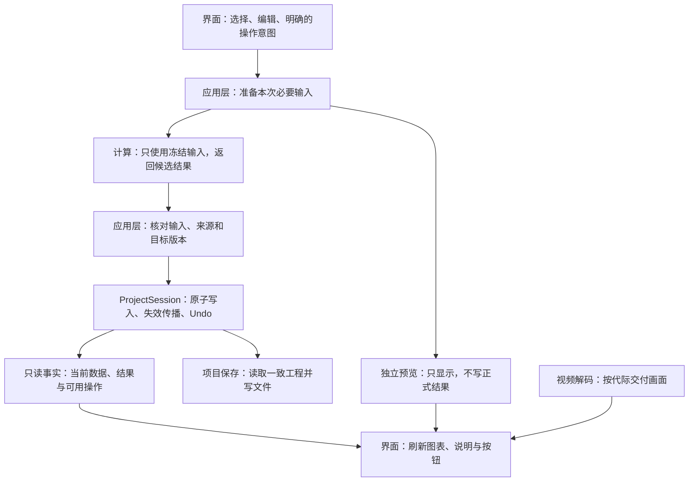

# 下一轮整体架构重构方案：贯通计算、结果写回与界面更新

- 日期：2026-10-18；核查基线：main `ab9e810`，R03集成提交`2600f2a`。
- 状态：**方案已形成，待用户确认；产品代码未实施。** 本次授权是编写方案，不代表已批准下面所有实施批次。
- 对应进度：R04，承接[重构进度表](architecture-progress.md)；R01–R03保持已完成。
- 本文描述目标架构；[architecture.md](../architecture.md)描述当前架构。接手Agent必须区分二者。

## 1. 推荐方向与实际影响

**下一轮建议重构分析主干：把“准备计算所需的数据 → 计算 → 核对结果 → 写回工程 → 更新各处显示”连成职责清楚的一条链路。** 这条主干同时服务普通图表、角运动、公式拟合、重复间隔和自动源准备，并与AI轨迹采用、项目保存及视频显示明确衔接。

对整个产品的收益是：以后修改一条计算或结果规则时，各入口自然沿用同一套实现；后台计算不再携带无关的会话历史和写入能力；界面显示的是已经确认的事实，较早的后台结果不能覆盖当前选择。后续增加比较、导出和模型复用功能，也能接到已有主干。

这轮主要提高维护可靠性和扩展能力。**不预先承诺计算更快、拟合更准确，也不以减少文件数、函数数作为成果。** 数值和操作体验应保持现状；性能收益需要单独测量才能声称。

## 2. 前三轮留下了什么基础

| 已完成工作 | 已经解决的问题 | 下一轮如何承接 |
| --- | --- | --- |
| R01 公式拟合联动，`aa86d79` | 缺失或过期的源能在当前页面准备，预览、单位和说明同步 | 保留这条入口，把它接到更清楚的计算与发布链路 |
| R02 计算设置统一，`26af812` | 标定、支点、平滑、时序等共同事实由`source_recipe`维护 | 继续作为唯一事实来源，不在新结构里重新定义一遍 |
| R03 重复间隔联动，`2600f2a` | 两个工具共用源准备和预览，正式结果仍由用户点击产生 | 保留独立预览及所有联动行为；被动更新不抢走滚动位置 |

前三轮已经改善“改了设置是否看得到效果”。下一轮处理支撑这些体验的整体职责分配，避免每新增一个入口，又把数据准备、计算、写入和显示重新拼一遍。

## 3. 当前真正需要调整的结构

### 3.1 工程会话同时承担计算与写入

`ProjectSession.compute_kinematics()`和`compute_angular()`同时读取数据、调用数值算法、组装结果、保留扩展字段并提交工程。后台任务为了复用它们，会持有一个分离的Session，调用这些带写入行为的入口，再把结果交回活动Session。

**现有后台不会直接修改用户正在操作的工程。** 问题在于：一次只需要计算的任务，仍携带了会话、历史栈和写入能力；理解和验证计算时，需要同时理解工程事务。

底层数值算法已经在domain中复用。下一轮要改变的是上层工作分工，不是另写一套数学算法。

### 3.2 同一工作流跨越多个角色，但职责尚未完全对齐

目前已经有`prepare_*`、`validated_*`、`apply_*`、`workflow_projection`等可复用入口。它们是目标架构的基础，不应全部推倒重来。

仍需贯通的是：同步计算入口和后台入口是否经过同一条结果构造、核对与写回路径；GUI是否只提供当前选择和操作意图；多个页面是否依据一致的事实更新，而不是分别猜测当前结果是否可用。

### 3.3 数据更新与界面动作需要明确分工

R03拖线跳顶说明：计算正确、曲线缩放正确，并不代表整页操作稳定。自动预览更新了提示，却误触发了“滚动到结果处”的显式操作反馈。

下一轮应把“事实变了，刷新显示”和“用户主动操作，需要定位或导航”分清。页面滚动、图表缩放和编辑草稿由界面持有；后台结果不拥有这些交互状态。

## 4. 目标架构：保留四层，收清各自的职责

图中表示职责顺序，**不表示新增一个包办所有任务的总控制器**。AI训练和推理保留自己的进程执行链路，候选轨迹仍须显式采用才进入工程；视频解码直接服务显示；保存直接读取工程并写文件，独立于计算流程。

| 工作 | 目标责任归属 | 对用户的意义 |
| --- | --- | --- |
| 当前工程、观测、结果、Undo | `ProjectSession`及现有事务入口 | 失败不会写入半套结果，撤销含义保持一致 |
| 数学算法 | 现有domain算法 | 各入口使用相同算法和单位口径 |
| 计算输入、结果构造、科学核对 | 各分析application module，共用现有事实与批次规则 | 图表、自动源准备和分析工具不会各走一套计算流程 |
| 实际计算设置 | `source_recipe` | 支点、平滑、标定和时序只解释一次 |
| 当前可用操作及原因 | 现有应用层准备规则、`workflow_projection`等只读投影 | 不同入口对同一状态给出一致解释 |
| 线程、进程、取消、交付 | 现有各类任务执行链路 | 预览不会排在正式计算前阻塞它，训练取消仍能回收进程 |
| 草稿、缩放、滚动、焦点、导航 | GUI | 自动刷新不会清空编辑内容或突然跳页 |
| 文件、视频解码、DLC实际调用 | 现有infrastructure及对应adapter | 平台差异集中处理，不渗入数学计算 |

当前允许的application与infrastructure公共符号依赖继续按项目规范处理；本轮不顺带改造所有引擎构造和导入方向。

## 5. 下一轮实施范围：三批贯通，一批收口

下面三批属于同一个R04整体目标。它们可以分别审查和合并，每批都必须形成可运行增量；全部必要入口迁移后，才把R04标为已完成。

### A. 计算脱离工程写入能力

覆盖位置、速度、加速度以及角位置、角速度、角加速度的完整计算和结果构造。同步入口、后台图表更新、拟合和重复间隔需要的源准备都接到同一实现。

- 计算输入使用现有`AnalysisInputs`、计算设置、角参考及确实需要的已有结果信息；不把整个Session或一组内部回调传进去。
- 后台线性和角运动任务不再持有Session，也不再调用`snapshot.compute_*()`。
- 冻结输入仍需保护嵌套参数和扩展字段；按需要复制，禁止原地修改共享字典，不通过复制整个工程来掩盖职责问题。
- 保留`ProjectSession.compute_*()`的外部用法，由它们协调准备、计算和受控写回。
- 数值函数、缺测断段、真实帧时间、单位、计算配方和旧扩展字段语义保持。
- UUID和时间戳继续按现有结果身份规则生成；结果等价检查比较科学内容，不要求每次身份字段相同。

**这一批完成的证据：** 同一份输入从同步入口、后台入口、自动源准备入口得到等价结果；计算期间没有临时Undo、工程写入或文件写入。不能只把旧函数换个文件存放。

### B. 让所有正式分析经过清楚的核对与写回路径

贯通线性、角运动、拟合、重复间隔四类正式结果。拟合和重复间隔已主要采用冻结输入，不为统一形式重写算法；重点核对其与上游源计算的衔接。

- 复用各自的`prepare_*` / `validated_*`及Session的`apply_*`，让同步与后台入口遵循相同的科学条件和事务含义。
- 计算返回候选结果；只有通过核对，才能改变活动工程及相关结果状态。
- 继续分别检查原始输入、源结果身份、被替换的目标版本、支点和时序权限。共同事实可以共用，各类特有核对保留。
- 未知字段保留、整组结果替换、相关结果标为需更新、失败不污染工程，必须在统一路径下仍成立。
- 不新增第二个“结果发布管理器”去包住现有Session提交入口。

**这一批完成的证据：** 输入变化、目标结果被其他操作替换、批次缺项、取消或失败时，所有入口都拒绝不适用的结果，工程和历史保持一致。

### C. 贯通应用事实与界面更新

沿着“已有轨迹 → Charts → 公式拟合 / 重复间隔 → 查看正式结果”的完整使用流程整理调用关系。

- GUI收集当前轨迹、区间、编辑值和任务瞬时状态；计算资格、源准备理由和科学来源说明由对应应用层规则提供。
- 复用现有`workflow_projection`、源准备及图表数据构造；只对已经有多个实际调用方的事实集中采集和解释。
- 不同页面读取同一工程事实，同时保留各自草稿和视图。不要用一个全局快照或一个`valid`标记替代不同用途的判断。
- 自动更新只刷新数据与说明；主动点击、定位、导航由明确的用户操作触发。
- 每迁移一条流程，就删除被替代的旧判断或旧调用路径，避免新旧两套同时运行。

**这一批完成的证据：** 从任一入口改变相关输入，其他相关页面正确更新；较早结果、只读历史和普通保存都不会意外触发正式分析，也不会抢走当前编辑位置。

### D. 整体收口与接手检查

对照上面的目标图逐条确认职责已落到实际代码。同步当前架构、完成进度、mini-plan、Review、README及必要的ADR；标明被替换的旧入口和保留的兼容入口。

兼容入口可以保留，但内部只能有一条权威实现。某条入口尚未迁移时，明确记录缺口，不能把整个R04提前标为完成。

## 6. 各部分如何连贯更新

| 用户或工程发生的变化 | 应有的整体响应 |
| --- | --- |
| AI推理完成但候选尚未采用 | 更新候选状态；分析仍依据当前已生效轨迹，不自动切换到未采用候选 |
| 显式采用AI候选或修正人工点 | 通过Session事务更新生效轨迹、使相关分析需更新；Charts与两个分析工具依据同一批生效数据刷新 |
| 修正一个原始轨迹点 | 相关旧派生结果标为需更新；当前工具按需准备源、刷新预览和说明；已有正式拟合 / 测量不被自动重做 |
| 应用新的标定、支点或平滑设置 | 采用确认后的设置更新受影响来源；单位、配方说明和预览一致；其他轨迹自己的设置不被借用 |
| 修改公式或交叉参考线 | 只更新当前草稿预览；图表范围、页面位置和正式结果保留 |
| 点击Fit或Measure | 捕获本次输入，正式计算后核对，再一次写回工程；各处读取同一份正式结果 |
| 切轨迹、视频、工程或进入历史 | 原任务按其协议取消或拒绝迟到交付；历史保持只读，不把旧结果画到新选择上 |
| 保存、保存失败或自动保存 | 保持现有保存 / Undo契约；查看上次保存结果依据最近成功保存的基线，不由当前预览冒充 |

这些响应描述受影响对象的更新关系，不意味着每次编辑都重算整个工程。后台预览、正式分析和文件保存仍有不同的执行及写入权限。

## 7. 整体设计中明确保留的差异

| 保留项 | 原因 |
| --- | --- |
| 预览与正式分析使用独立执行器 | 预览不能阻塞用户主动发起的计算，且不能产生正式结果 |
| AI训练 / 推理使用现有spawn及取消回收流程 | 进程、模型运行和强制回收有独立要求 |
| 视频使用队列、无参唤醒及代际核对 | 已有Windows交付问题的防护不能被通用任务封装替换 |
| 保存保留自己的执行流程 | 文件写入阶段不可取消，保存与自动保存的历史语义不同 |
| Session保留Undo及事务所有权 | 本轮梳理计算职责，不重写历史系统或回滚后台进展 |
| 两套图表保留交互差异 | 源帧导航、相空间、拟合残差和参考线不是同一种交互 |

因此R05全局`JobSupervisor` / `WorldSnapshot`、R06 Undo拆分 / 通用图表渲染器继续后置。整体优化来自职责和数据流一致，不要求所有任务变成同一种任务。

本轮方案也不包含新依赖、工程格式迁移、ODE、新的误差算法、Phase 7模型库或Phase 8导出实现。目标架构为后续工作提供接入位置，后续功能仍需另行规划。

## 8. 完成标准与验证方式

以下全部是**待实施的验收建议**，不代表本次已完成验证。

- [ ] 同步计算、后台图表更新和自动源准备共用无Session写入的计算实现；线性 / 角运动worker不携带Session。
- [ ] 四类正式分析都有清楚的准备、计算、核对和写回关系；计算职责退出Session后，事务和Undo仍由Session拥有。
- [ ] 同样输入得到等价的数值、单位、配方及科学来源；未知扩展、缺测段、真实时间和角度分支规则保持。
- [ ] 输入、来源或目标版本变化时原子拒绝；取消 / 失败 / 保存忙 / 换上下文不造成半批写入或迟到覆盖。
- [ ] R01–R03的联动、历史只读、显式Fit / Measure、草稿保护、图表缩放和页面滚动全部保持。
- [ ] AI候选采用、视频解码和保存仍经过各自既有入口；没有为了统一而绕开专属核对。
- [ ] 被替代的旧计算 / 判断路径真正退出；保留的兼容入口指向同一实现，没有新增一个只有转发作用的总管理器。
- [ ] 当前架构图、依赖检查、计划和进度一致；下个Agent可以识别实际owner及唯一调用路径。

数值沿用已有解析数据测试；补充同步 / 后台 / 自动源准备的等价和无写入验证，保留结果核对与Undo回归。测试以可见行为和调用契约为主，仅少数直接替换`snapshot.compute_*`的测试需要随旧路径退出而调整。

每批先跑相关测试；最终跑全量及macOS / Windows CI，并进行只读独立复审。A / B若保持纯内部变化，不额外设体验审批；C若改变信号连接或反馈归属，针对相关交互给出不超过5步的真人回归。发现体验变化则返工，不把行为改变藏在结构调整中。

不设置未经测量的提速百分比、固定行数下降比例或新手完成时限。

## 9. 实施前提与停止点

**建议用户先确认“是否以A–D为下一轮整体范围”。** 确认后再冻结可执行mini-plan、分支和架构决策；本方案不是Accepted ADR，不覆盖已有验收标准。

实施顺序为A → B → C → D。每批写清输入、输出、需要删除的旧路径、验证证据及完成标记；只有真正独立的工作才安排并行，计算输入与提交契约的连续决策由同一负责人把关。

遇到以下情况，先调整方案，不靠扩大抽象继续推进：计算仍必须接收Session和大量内部回调；统一后需要成串任务类型分支；为了迁移而要求删掉来源核对、改变Undo或改工程格式。它们说明职责切分还不合适。

R04完成后更新进度并停止，不自动启动R05 / R06或下一产品阶段。

## 附录：供实现Agent接手

### 当前事实与拟改动位置

| 位置 | 已核对的现状 | 拟调整方向 |
| --- | --- | --- |
| [project_session.py](../../src/ai_physics_tracker/application/project_session.py) | `compute_*`兼管计算 / 结果装配 / 提交；`apply_*`及`_commit_store`已有统一事务路径 | 计算实现退出，协调入口与事务所有权保留 |
| [kinematics_job.py](../../src/ai_physics_tracker/application/kinematics_job.py)、[angular_job.py](../../src/ai_physics_tracker/application/angular_job.py) | job持有detached Session，worker调用`snapshot.compute_*` | 仅携带实际冻结输入；共用无会话写入计算，保留专属核对 |
| [signal_analysis_job.py](../../src/ai_physics_tracker/application/signal_analysis_job.py) | 已有冻结源、纯预览、正式结果构造及双版本核对 | 作为现有参照，接稳上游源；不强行重写成通用任务 |
| [source_recipe.py](../../src/ai_physics_tracker/application/source_recipe.py) | 配方共同事实的唯一owner | 保留，计算与来源说明继续共用 |
| [workflow_projection.py](../../src/ai_physics_tracker/application/workflow_projection.py)、[chart_data.py](../../src/ai_physics_tracker/application/chart_data.py) | 已有应用状态投影与结构化图表来源事实 | 承接真实共用的事实，不另建全局状态容器 |
| [chart_actions.py](../../src/ai_physics_tracker/gui/chart_actions.py)、[signal_preview.py](../../src/ai_physics_tracker/gui/signal_preview.py)、[main_window.py](../../src/ai_physics_tracker/gui/main_window.py) | Qt交付 / 专属核对 / 界面状态仍存在跨文件协作 | 准备与科学规则归应用层，交互状态归GUI；删除迁移后的旧路径 |
| [tracking_job.py](../../src/ai_physics_tracker/application/tracking_job.py)、[tracking_actions.py](../../src/ai_physics_tracker/gui/tracking_actions.py)、[project_actions.py](../../src/ai_physics_tracker/gui/project_actions.py) | AI候选、进程回收、保存各有已接受语义 | 作为整体兼容边界；不因为分析重构改写其运行协议 |

文件名和新类型需在实施设计时按实际职责确定；此时不预建空文件或先堆接口。

### Agent Context Pack / Review Gate

- 当前事实：[architecture.md](../architecture.md)、[进度表](architecture-progress.md)、[current.md](current.md)、[术语](../../GLOSSARY.md)。旧GLM输入及判断见[首次复核](../notes/architecture-review-assessment-2026-10-17.md)、[后续复核](../notes/architecture-followup-2026-10-18.md)，其中尚未实施的旧状态以当前进度覆盖。
- 保留契约：ADR-[0012](../decisions/0012-gui-tracking-task-boundaries.md)、[0017](../decisions/0017-user-defined-equation-analysis-platform.md)、[0019](../decisions/0019-angular-kinematics-and-multi-input-derived-data.md)、[0020](../decisions/0020-analysis-batch-result-and-recipe-consistency.md)、[0021](../decisions/0021-function-fit-and-recurrence-result-contract.md)、[0023](../decisions/0023-preview-task-isolation.md)、[0024](../decisions/0024-automatic-near-cfr-acceptance.md)、[0025](../decisions/0025-automatic-fit-source-preparation.md)、[0026](../decisions/0026-live-recurrence-preview.md)。Accepted ADR不改正文，必要时另起新决策。
- 回归入口：`tests/test_kinematics_job.py`、`test_angular_job.py`、`test_signal_analysis_job.py`、`test_source_recipe.py`、`test_angular_session.py`、`test_project_session.py`、`test_undo_run_integrity.py`、`test_workflow_projection.py`及`tests/gui/`中的源准备 / 历史 / 预览 / 交互回归。
- 依赖约束由`tests/test_layer_boundaries.py`承接；实施时增加计算不依赖Session及GUI的针对性检查，不能只检查换了目录。
- **High-risk**：涉及科学输入、结果构造、事务及后台交付，必须提前声明Independent Review；是否需要Human Review按第8节及项目规则判断。

### 设计自检

每个module应通过较小的interface提供完整行为，使职责具有locality，多个真实调用方获得leverage。seam应位于冻结计算输入和受控结果写回之间；GUI及实际执行环境作为adapter保留各自语义。

做deletion test：移除新module后，如果只是少了一层转发，它没有带来depth；如果调用方又必须了解结果构造、来源和计算细节，才说明职责真正集中。新测试应跨越实际调用interface，而不是围绕新建的小函数机械复述实现。

### 本次文档工作的验证范围

本次核对已完成进度、既有决策和上述关键源码调用关系；检查文档链接及格式。**没有实施产品重构，没有新增测试、运行全量测试、测量性能或完成未来架构验收。**
