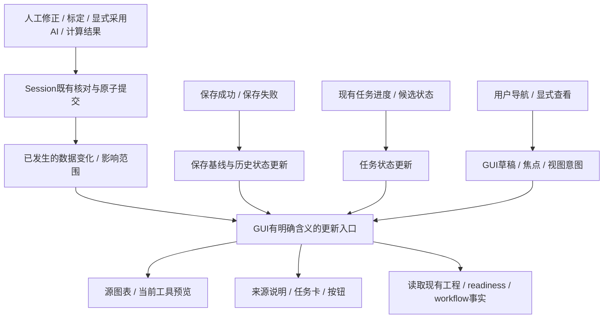

# R07下一轮方案与待办：工程变更如何连贯更新界面

- 日期：2026-10-18；核查基线：main `085219e`，R04已通过本轮真人验收并集成。
- 状态：**用户在2026-10-18讨论后搁置，未实施。** 用户认为使用上没有必要继续此项；T01–T08不启动。改为[复核GLM剩余建议](../notes/glm-remaining-review-2026-10-18.md)。 R05全局任务管理 / 全局快照、R06 Undo重写 / 通用绘图继续后置，编号不复用。
- 接手顺序：[当前架构](../architecture.md) → [完成进度](architecture-progress.md) → [current](current.md)。本文件描述建议，不能覆盖已落地架构。

## 1. 推荐做什么，实际改善什么

**下一轮整理“改了一处，所有相关界面如何一起更新”这条主干。** 覆盖标注 / AI轨迹采用 → 源图表 → 拟合 / 重复间隔 → 保存与历史显示，延续R04已有计算与写回路径。

用户修正一个点后，依赖它的图表和预览应该跟着更新；保存成功后，保存状态和历史入口应该更新；切页面时，草稿、预览及按钮按当前页面变化。每种变化都应有清楚的传播范围和显示方式。

本轮的价值是让后续修改一条更新规则时，各个入口沿用相同含义，减少“这里变了、另一处没跟上”及被动刷新误触导航的机会。**当前保护已有效，本方案没有发现并宣称一批新的用户故障，也不预先承诺提速或数值更准确。**

R04整理了“怎样计算、怎样安全写回”；R07承接它，整理“写回之后哪些地方知道发生了什么”，并区分数据、任务状态、保存基线和用户导航。

## 2. 为什么现在值得整理

本次源码核对发现：

| 当前关系 | 维护时需要额外理解什么 |
| --- | --- |
| MainWindow._refreshHistoryButtons刷新Undo等按钮，同时emit analysisChanged | 接收方须再次判断是否真的改了科学输入 |
| 切工作区、分析标签、方法也emit同一个analysisChanged | 导航与数据变化的含义散落在各接收方 |
| ProjectActions保存成功后经_refreshHistoryButtons进入这条通知链 | 普通保存也要求分析接收方排除无关刷新；Save与autosave历史语义还须分别保留 |
| ChartActions、TrackingActions、FrameSelectionActions、ModelActions、BatchAnnotationActions、SuggestedFrameReviewActions及来源条均消费该通知 | 一项含义变化必须同时理解多个角色，遗漏消费者会造成迁移不完整 |
| ChartActions._analysisChanged已注明保存 / 视图也发此信号，并核对实际输入后才取消任务 | 现有guard应保留；通知可更明确，减少每处重新辨认变化原因 |

已有domain.mark_tracks_stale / mark_calibrations_stale、stale_analysis_dependents及Session事务提供失效传播；R04的analysis_readiness和各job提供资格与写回核对。**继续复用这些规则。** 新通知用于指导更新，不授予科学结果有效性，也不代替版本核对。

## 3. 目标关系

图中的“更新入口”表示清楚的调用关系；具体类型和文件在实施计划冻结时确定。保留现有Qt信号、定时器及任务协议，不新增全局事件总线、任务总管或第二份工程状态。

| 职责 | 继续归谁 | 本轮收清什么 |
| --- | --- | --- |
| 科学输入、依赖失效、事务、Undo | domain / ProjectSession | 数据变化通知只在成功提交后发布，失败无假成功通知 |
| 变化事实与影响范围 | 无Qt的应用层值与实际写入入口 | 说明影响哪个视频 / 轨迹、数据还是保存基线；已有事实只读引用，不复制整个工程 |
| 通知与刷新调度 | GUI现有入口 | 一次变化的消费规则明确，必要的同轮刷新合并；不重复发新旧两路 |
| 可计算资格与来源 | analysis_readiness / source_recipe / 既有prepare与validated | 继续唯一解释；通知范围不能使过期结果变有效 |
| 任务取消、进程回收、迟到拒绝 | 现有各任务执行链 | 按专属条件判断；保留输入 / 源 / 目标 / generation / request_id核对 |
| 滚动、缩放、草稿、焦点 | GUI | 被动更新只更新显示；明确的用户操作才执行定位 |

## 4. 连贯更新的验收场景

| 操作或事件 | 应有结果 |
| --- | --- |
| 修正人工点、删除点或采用AI候选 | 先完成原子事务及已有失效传播；相关源 / 预览 / 说明随生效数据更新；既有正式Fit / Measure不自动重做 |
| AI训练 / 推理进度变化、推理候选完成但未采用 | 更新进度和候选显示；分析仍使用当前生效轨迹 |
| 更新标定、工作区间、确认角参考或修改平滑设置 | 按各自已接受语义更新受影响内容；其他轨迹设置归属保持；未Apply参考不能冒充已应用值 |
| 正式计算成功 / 失败 / 取消 | 成功写回后相关显示一致；失败 / 取消保留工程与正式结果；自动源任务不滚动定位 |
| 显式Save、静默autosave | 均刷新对应保存状态 / 历史事实，不冒充科学输入变更；Save清Undo、autosave保留Undo/Redo的既有契约保持 |
| 切工作区 / 分析方法 / 轨迹、回看历史 | 更新当前可见内容及草稿；进入工具仍可按R01–R03规则准备缺失源和预览，Fit / Measure仍显式；历史只读 |
| 切工程 / 视频、关闭窗口、迟到回调 | 沿用代际与资源回收协议；旧交付不能影响新选择；关闭过程不恢复旧界面 |
| 通知范围不明确、旧兼容入口调用 | 按保守规则重新核对，不能因为缺少精确信息而漏刷新或放行结果 |

## 5. 待办清单与顺序

以下是可跟踪的整体清单；实施时沿用ID，不把“已写方案”标成“已重构”。每项完成须补实际commit、相关验证及删除的旧路径。

### 本次已完成的准备

- [x] P01：R04本轮HR通过、085219e合并；核对代码 / 测试与bd848f1一致。
- [x] P02：核对工程变更、保存、导航的通知来源与7类消费者；确认既有失效 / 科学guard可复用。
- [x] P03：形成此方案、影响表、待办及停止点；产品实现尚未开始。

### 待实施（建议一个完整R07周期）

- [ ] T01 **冻结变更影响表**：逐条登记所有发出点及消费者、成功 / 失败 / 取消 / 切换后的行为。不能只迁移图表而遗漏AI审核 / 批量标注 / 模型提示。完成判据：每条旧通知都有去向与测试入口。
- [ ] T02 **确定最小变化事实与兼容方式**：分清科学数据、保存基线、任务状态及视图意图；保留视频 / 轨迹范围和未知范围的保守路径。形成mini-plan、Context Pack、High-risk Review Gate及必要ADR。完成判据：调用方无需传整份Session或任意回调；无第二份状态、无新依赖 / 格式。
- [ ] T03 **贯通数据写回后的通知**：覆盖人工点、轨迹 / 标定 / 区间、显式AI采用、线性 / 角运动 / 拟合 / 重复间隔发布及Undo/Redo恢复。复用现有事务。完成判据：成功后相关消费者一致更新，原子失败无数据变化通知，双轨迹参考与无关轨迹保护保持。
- [ ] T04 **贯通保存与任务状态更新**：保存成功 / 失败、autosave、训练 / 推理进度、未采用候选分别传递明确事实。完成判据：普通保存不触发源重算或取消有效任务；历史基线、Undo语义、候选不生效语义保持。
- [ ] T05 **贯通导航、历史与被动显示**：迁移分析工作区 / 工具 / 目标切换，及状态头、按钮、来源条、图表、审核 / 批量面板的消费。完成判据：草稿和页面位置保持，旧任务不覆盖新选择；显式操作定位正常，进入工具自动准备能力保持。
- [ ] T06 **退出重载的旧通知链**：取消“只刷新历史按钮就等同分析变化”的隐式关系；保留必要兼容入口时只转入同一权威路径。完成判据：所有真实调用方迁移；没有新旧通知双发，也没有每个消费者各维护一份变化分类表。
- [ ] T07 **完整验证与独立复审**：覆盖上表正向 / 无关变化 / 拒绝路径，定向后全量及macOS / Windows CI，Independent Review闭环。仅对明确重复刷新问题验证调用数量，不设置未经测量的速度目标。
- [ ] T08 **真人验收、文档与集成**：≤5步独立副本HR，用户通过后--no-ff合并；同步架构图、进度表、计划 / Review、current / README / roadmap / AGENTS，push并停止。

顺序为T01–02 → T03–05 → T06 → T07–08。连续的通知契约由同一负责人把关；独立复审在冻结Gate中声明。

## 6. 保留边界与停止条件

计算算法、JSON格式、时序 / 单位、未知字段、源与目标双版本、Undo事务及AI激活规则保持。R04无会话写入计算、独立预览和源资格规则直接复用。解码队列、无参唤醒、进程强制回收、保存不可取消阶段继续走各自协议。

下列情况先调整设计：

- 只有给analysisChanged换名字，调用方仍需自行猜变化原因；
- 必须复制整个Project、不断扫描全部观测，或让每个事务接收大量回调；
- 精细范围不足以证明正确，却删除兜底刷新或既有科学guard；
- 新建通用总控制器后，大量任务类型分支和特殊协议被迫塞进同一处。

T01若证据表明现有关系已足够清楚且没有完整迁移收益，应记录结论并停下，不为减少信号数量继续重写。T02遇到不兼容契约、依赖或范围变化按项目规则处理。

R07完成后，再单独冻结6.4多轨迹比较 / 误差解释：届时复用当前计算 / 来源 / 写回及明确更新关系。R05 / R06、ODE、单位管理、模型库及导出仍须另行规划。本方案不等于授权实施这些后续功能。

## 7. Agent Context Pack / 验证入口

- AGENTS / CODE_STANDARD / 当前架构 / architecture-progress / phase6-requirements及phase-6-plan。
- ADR-0012 / 0019 / 0020 / 0021 / 0023–0027；R01 F1–F3、R03 F1、R04 F1；pre-phase6-project-review P6R-01与undo_run_integrity。
- 源码：gui/main_window、project_actions、chart_actions、signal_preview、tracking_actions、model_actions、batch_annotation_actions、suggested_frame_review_actions、timing_actions；application/project_session、analysis_readiness、workflow_projection；domain/derived、analysis。
- 回归：tests/gui/test_analysis_workflow_facts、test_fit_source_updates、test_recurrence_preview、test_workflow_ui、test_project_actions、test_signal_history_view、test_tracking_activation_actions、test_chart_request_identity、test_timing_actions；test_undo_run_integrity及既有job版本 / 取消测试。
- 实施前读research/open-source-project-map对应GUI与后台小节，选择具体设计后只引用必要材料，不引入通用事件框架。

本次验证限于已有源码关系核对、R04集成树一致性、文档链接 / 状态检查。R07产品没有实现，没有R07独立复审 / 新HR或性能证据。
